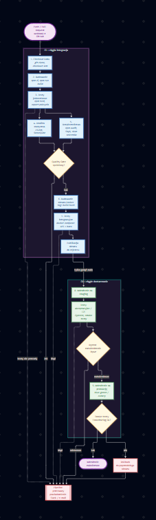
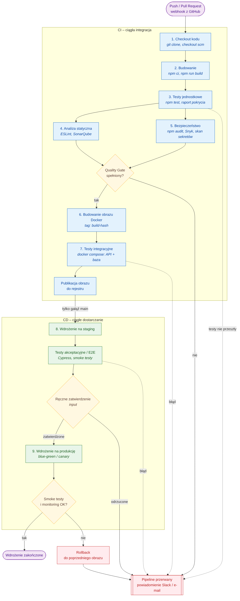

# Zadanie 27 – Diagram Mermaid pipeline'u CI/CD w Jenkinsie

## Pliki

| Plik | Zawartość |
|------|-----------|
| `jenkins-pipeline.md` | Kod diagramu Mermaid (renderowany bezpośrednio przez GitHub) |
| `img/zadanie-27-diagram.png` | Zrzut ekranu diagramu z Mermaid Live Editor |
| `img/zadanie-27-diagram-hd.png` | Ten sam diagram wyrenderowany w wyższej rozdzielczości (Mermaid CLI) |

## Diagram

Zrzut ekranu z Mermaid Live Editor:



Wersja w wyższej rozdzielczości:



## Legenda

| Kolor / kształt | Znaczenie |
|-----------------|-----------|
| Niebieski prostokąt | Etap CI – wykonywany na każdej gałęzi |
| Żółty romb | Punkt decyzyjny (bramka jakości, zatwierdzenie, weryfikacja wdrożenia) |
| Zielony prostokąt | Etap CD – wdrożenie i testy na środowiskach |
| Czerwony prostokąt | Ścieżka błędu – przerwanie pipeline'u lub rollback |
| Fioletowy owal | Początek i koniec przepływu |
| Linia ciągła | Normalny przepływ lub decyzja |
| Linia przerywana | Awaria etapu |

## Zależności między etapami

Pipeline dzieli się na dwie części. **CI (ciągła integracja)** sprawdza każdą zmianę w kodzie, na każdej gałęzi. **CD (ciągłe dostarczanie)** wdraża zmiany i uruchamia się wyłącznie dla gałęzi `main`. Każdy etap korzysta z wyniku poprzedniego, a błąd w dowolnym miejscu przerywa przepływ.

### Część CI

| Etap | Zależy od | Dostarcza | Dlaczego w tym miejscu |
|------|-----------|-----------|------------------------|
| **1. Checkout kodu** | zdarzenie push / PR (webhook) | kod źródłowy w konkretnej rewizji | wszystkie dalsze etapy operują na tym kodzie |
| **2. Budowanie** | 1 – kod źródłowy | zainstalowane zależności, skompilowana aplikacja | testy i analiza wymagają zależności i zbudowanego kodu |
| **3. Testy jednostkowe** | 2 – zbudowana aplikacja | wyniki testów, raport pokrycia | najszybsza i najtańsza weryfikacja logiki – błąd przerywa pipeline najwcześniej |
| **4. Analiza statyczna** | 3 – przetestowany kod, raport pokrycia | metryki jakości (code smells, duplikacja, pokrycie) | SonarQube wykorzystuje raport pokrycia z testów |
| **5. Bezpieczeństwo** | 3 – kod i lista zależności | raport podatności zależności i wykrytych sekretów | nie ma sensu skanować kodu, który nie przechodzi testów |
| **Quality Gate** | 4 **i** 5 jednocześnie | decyzja: kontynuować czy przerwać | jedna bramka łączy wyniki obu analiz |
| **6. Budowanie obrazu Docker** | Quality Gate – spełniony | obraz z niezmiennym tagiem `build-hash` | obraz powstaje tylko z kodu, który przeszedł wszystkie kontrole |
| **7. Testy integracyjne** | 6 – zbudowany obraz | potwierdzenie współpracy aplikacji z bazą i innymi usługami | testuje **ten sam obraz**, który trafi na środowiska – nie kod źródłowy |
| **Publikacja obrazu** | 7 – testy integracyjne zaliczone | obraz w rejestrze | do rejestru trafia wyłącznie obraz zweryfikowany integracyjnie |

**Etapy 4 i 5 działają równolegle.** Obie analizy potrzebują tylko kodu z etapu 3 i nie zależą od siebie nawzajem. Równoległe wykonanie (blok `parallel` w Jenkinsie) skraca czas pipeline'u. Quality Gate czeka na zakończenie **obu** – to jedyne miejsce, gdzie dwie ścieżki się łączą.

### Przejście CI → CD

Krawędź „tylko gałąź `main`” to warunek `when { branch 'main' }`. Gałęzie funkcjonalne i pull requesty przechodzą całe CI – programista dostaje informację zwrotną o jakości kodu – ale nie są wdrażane.

### Część CD

| Etap | Zależy od | Dostarcza | Dlaczego w tym miejscu |
|------|-----------|-----------|------------------------|
| **8. Wdrożenie na staging** | obraz w rejestrze | działająca aplikacja w środowisku zbliżonym do produkcji | sprawdzenie wdrożenia na kopii produkcji, bez ryzyka dla użytkowników |
| **Testy akceptacyjne / E2E** | 8 – działający staging | potwierdzenie działania całych scenariuszy użytkownika | wymagają w pełni wdrożonego systemu z frontendem, API i bazą |
| **Ręczne zatwierdzenie** | testy E2E zaliczone | decyzja człowieka (krok `input`) | świadoma decyzja o wydaniu – termin, komunikacja, ryzyko biznesowe |
| **9. Wdrożenie na produkcję** | zatwierdzenie | nowa wersja dla użytkowników | **ten sam obraz** co na stagingu – bez przebudowywania |
| **Smoke testy i monitoring** | 9 – wdrożona produkcja | decyzja: wersja działa czy rollback | ostatnia linia obrony – błędy widoczne dopiero przy prawdziwym ruchu |

### Ścieżki błędu

| Źródło | Typ krawędzi | Skutek |
|--------|--------------|--------|
| Testy jednostkowe nie przeszły | awaria (przerywana) | pipeline przerwany, powiadomienie |
| Quality Gate niespełniony | decyzja (ciągła) | pipeline przerwany, obraz nie powstaje |
| Testy integracyjne nie przeszły | awaria (przerywana) | obraz nie trafia do rejestru |
| Testy E2E na stagingu nie przeszły | awaria (przerywana) | brak wdrożenia na produkcję |
| Wdrożenie odrzucone | decyzja (ciągła) | wersja zostaje na stagingu |
| Smoke testy / monitoring wykazały problem | decyzja (ciągła) | automatyczny **rollback** do poprzedniego obrazu, potem powiadomienie |

Wszystkie ścieżki błędu kończą się w jednym węźle z powiadomieniem (Slack / e-mail) – w Jenkinsie odpowiada to blokowi `post { failure { ... } }`.

## Zasady wynikające z diagramu

**Fail fast – od najtańszego do najdroższego.** Kolejność etapów rośnie z kosztem i czasem: testy jednostkowe trwają sekundy, analiza minuty, testy integracyjne wymagają uruchomienia kontenerów, a E2E – całego środowiska. Im wcześniej błąd zostanie wykryty, tym taniej go naprawić.

**Build once, deploy many.** Obraz jest budowany raz (etap 6), a następnie ten sam artefakt przechodzi przez testy integracyjne, staging i produkcję. Wdrażany jest dokładnie ten kod, który został przetestowany. Rollback polega na przywróceniu poprzedniego obrazu z rejestru – dzięki niezmiennemu tagowi `build-hash` wiadomo, który to jest.

**Bramki jakości.** Trzy punkty decyzyjne (Quality Gate, ręczne zatwierdzenie, weryfikacja po wdrożeniu) zabezpieczają przejście do kolejnej, bardziej ryzykownej fazy. Pierwsza jest w pełni automatyczna, druga wymaga człowieka, trzecia automatycznie cofa zmiany.

**Rozdzielenie CI i CD.** CI daje szybką informację zwrotną na każdej gałęzi, CD działa tylko na gałęzi głównej. Dzięki temu eksperymentalny kod nigdy nie trafia na środowiska, a mimo to jest w pełni sprawdzany.

## Uwagi

- Zrzut ekranu pochodzi z Mermaid Live Editor w ciemnym motywie. Wersja HD została wygenerowana z tego samego kodu przez Mermaid CLI (`mmdc`), co jednocześnie potwierdza poprawność składni.
- Plik `jenkins-pipeline.md` zawiera kod w bloku ` ```mermaid `, który GitHub renderuje automatycznie. Do Mermaid Live Editor należy wkleić sam kod, bez linii ` ```mermaid ` i ` ``` `.
