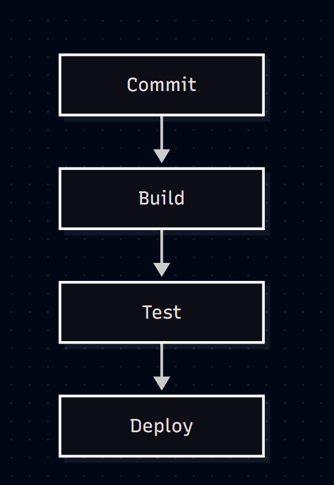

# Zadanie 6: diagram Mermaid – proces CI/CD

Model poproszono o prosty diagram Mermaid przedstawiający etapy potoku CI/CD, a następnie o kod gotowy do wklejenia w Mermaid Live Editor. Diagram wyrenderowano w edytorze i zapisano zrzut ekranu.

## Prompt 1 (diagram procesu)

```
Stwórz prosty diagram Mermaid pokazujący proces CI/CD: commit → build → test → deploy.
```

### Odpowiedź modelu


Programista wypycha zmiany do repozytorium (commit), co uruchamia potok CI. System buduje aplikację (build), następnie uruchamia testy automatyczne (test), a jeśli wszystkie przejdą, nowa wersja trafia na środowisko docelowe (deploy). Błąd na którymkolwiek etapie zatrzymuje potok, więc wadliwy kod nie dociera na produkcję.

## Prompt 2 (kod do Mermaid Live Editor)

```
Podaj mi kod który będę mógł wkleic do mermaid live editor
```

### Odpowiedź modelu

Kod należy wkleić bez znaczników bloku ```` ```mermaid ````. Do zrzutu ekranu użyto układu pionowego (`TD` zamiast `LR`):

```
flowchart TD
    A[Commit] --> B[Build]
    B --> C[Test]
    C --> D[Deploy]
```

## Wynik w Mermaid Live Editor



## Opis

Diagram przedstawia liniowy potok CI/CD złożony z czterech etapów. Commit inicjuje proces, build kompiluje i pakuje aplikację, test weryfikuje jej poprawność testami automatycznymi, a deploy publikuje sprawdzoną wersję na środowisku docelowym. Każdy etap uruchamia się dopiero po pomyślnym zakończeniu poprzedniego, dzięki czemu błędy wykrywane są możliwie wcześnie, a na produkcję trafia wyłącznie przetestowany kod.
